# GlimpseGG

**English** · [Português (pt-BR)](README.pt-BR.md)

Desktop app for Dota 2 post-game analysis. It reads public OpenDota data, with hero and item art
from Valve, and turns a finished match into a tactical read: scoreboard, advantage timeline, vision
map and per-player insights. **No API token is required.**

Built with Electron + React + TypeScript + Vite. The interface ships in Portuguese (pt-BR) and
English (en-US).

## Why it exists

GlimpseGG started as a way to **keep up to date what STRATZ used to show**. STRATZ stopped receiving
updates, and the cost shows up on every patch — new heroes and items never make it into the
datasets, so matches containing them are displayed incorrectly and fall out of any analysis.

The first versions read from the STRATZ API and required a personal token. That is no longer the
case: **the app makes no call to STRATZ and needs no token.** Profile, match and meta data come from
OpenDota, which is public; hero and item art comes from Valve.

The screens, and the kind of read they try to give, remain **inspired by STRATZ** — credit where it
is due. What GlimpseGG cannot do is reproduce STRATZ's own numbers, and it does not pretend to: the
impact score shown here is called **Glint**. It is GlimpseGG's own, it is **experimental**, and it
is neither STRATZ's IMP nor claimed to match it.

## Features

A sidebar with five sections — **Home**, **Matches**, **Heroes**, **Account** and the **Hero
grid** — that collapses into an icon rail.

**Home** — two columns. The main one has your last match, with its replay status and the "Request
replay analysis" button right there, and the matches before it. The side one has recent form with
a Glint line, a ring of the heroes in your last 25 or 100 matches colored by win rate, teammates
(click one to open their account) and activity.

**Matches, Heroes, Account**
- Match list that loads past the first 40, filtered by period and patch
- Your record on every hero, by period and patch, with the hero you pick and its latest matches beside the list
- Your Glint, win rate and farm over time, plus career totals (each with its own sample size), records, and breakdowns by patch, queue, lane and side

**Match analysis** — the replay's status decides the layout
- **Not analyzed yet:** the match opens as a scoreboard, says so, and offers to request the
  analysis. OpenDota parses replays on request, so this is the common case.
- **Analyzed:** five tabs with one player picker. Your own matches open on My game.
  - `SUMMARY` — highlights, gold/XP advantage, turning point, scoreboard
  - `MY GAME` — lane verdict (net worth **and** XP at 10 min, both shown), lane efficiency,
    item timings and active item usage, what your deaths cost, radar
  - `FIGHTS` — what each team fight cost each side and which objectives fell after it
  - `VISION` — real wards on the minimap, with lifetime, placer, dewards and coverage
  - `COACHING` — deterministic diagnosis; every card states where its number comes from
- **Glint** — the experimental per-player impact score (see [Why it exists](#why-it-exists))

What each tab shows depends on what OpenDota has for that match. When a piece of data is missing,
the section is hidden — it is never estimated. Build recommendations and minute-by-minute coaching
against the hero average are hidden for that reason: OpenDota does not have the volume to back
them.

**Hero grid mirror** — writes a copy of your in-game hero layout, reordered by win rate
- Your layout is never touched: the mirror is a **new entry** beside it, and the write aborts if
  anything else in the file changed
- Ordered by GlimpseScore, which blends the patch's meta win rate with your own history
- Needs no token — the meta win rate comes from OpenDota

## Screens

The captures below come from the running app (version 2.0, patch 7.42). The profile shown is a
public high-rank account (`86745912`), used only to illustrate the screens — none of the
maintainer's data appears here. That account has no unanalyzed recent match, so the scoreboard
mode is shown with another public match (`9091277624`), opened through search. Scoreboards,
teammates and records show other players' public nicknames and avatars, as Dota and OpenDota do.
The hero grid screens use a **fictitious layout** grouped by the four attributes, the way Dota ships
it by default: a hero grid is a local file, so there is no such thing as another player's grid to
show.

**Home** — the last match and the ones before it; recent form, the hero ring, teammates and activity on the side.

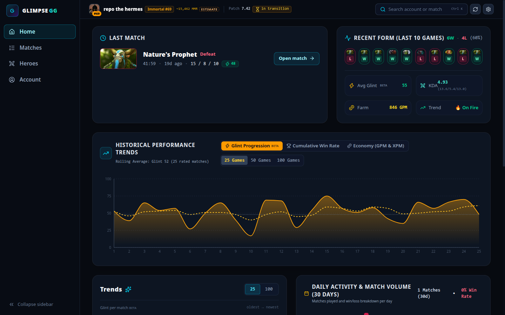

**Match not analyzed yet** — the scoreboard, the highlights that only need the scoreboard, and the
card that requests the replay analysis and lists what it unlocks.

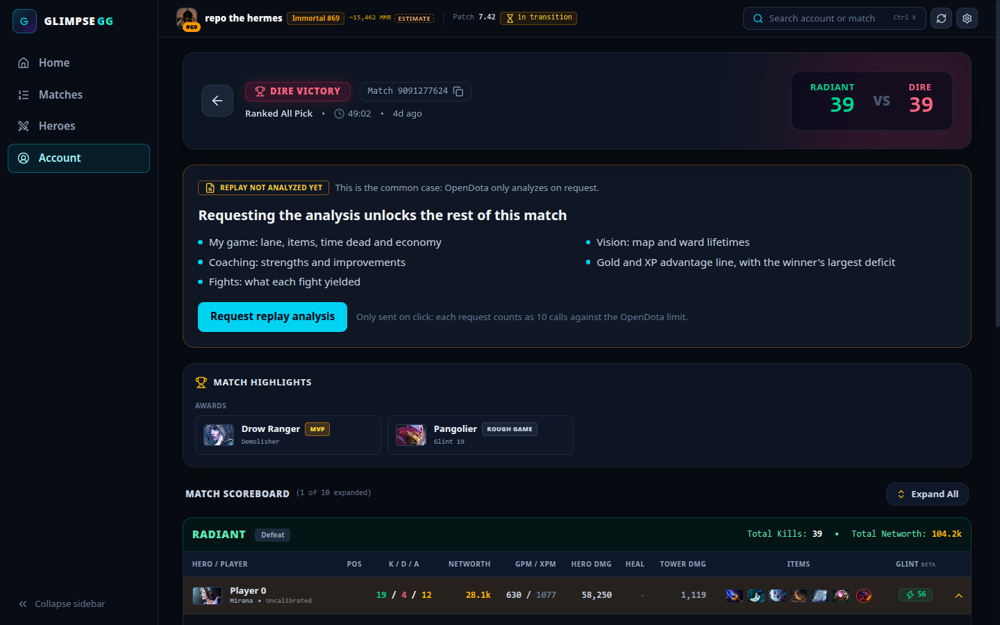

**`SUMMARY`** — awards, who led the match, best of each position, team comparison, the gold/XP
advantage and the scoreboard.

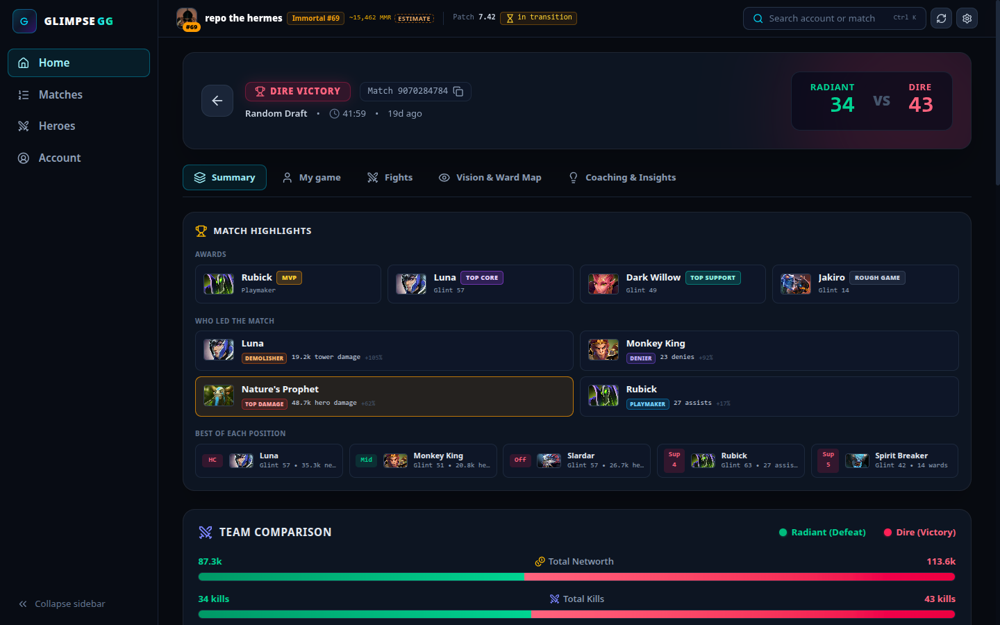

**`MY GAME`** — active item usage (recorded uses, rate as a floor), the radar with its estimate
chip, and the lane verdict with **both** differences at 10 minutes, net worth and XP.

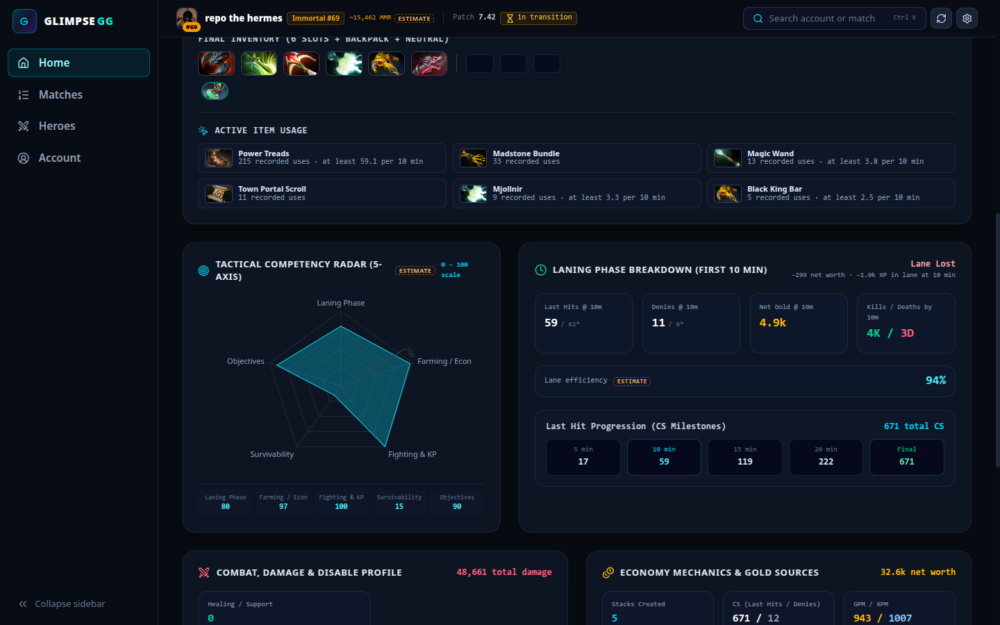

**`FIGHTS`** — each team fight, what it yielded for each side, what the selected player did in it,
and the objectives that fell before the next fight. No "fight won" badge: no criterion for it was
measured.

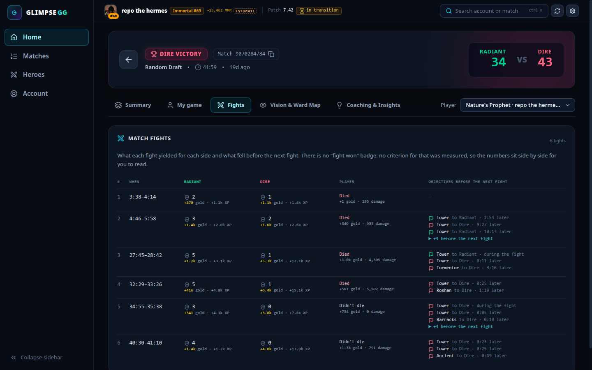

**`VISION`** — real wards over the minimap, with vision radius, lifetime, placer, dewards and
coverage, navigable through the match timeline.

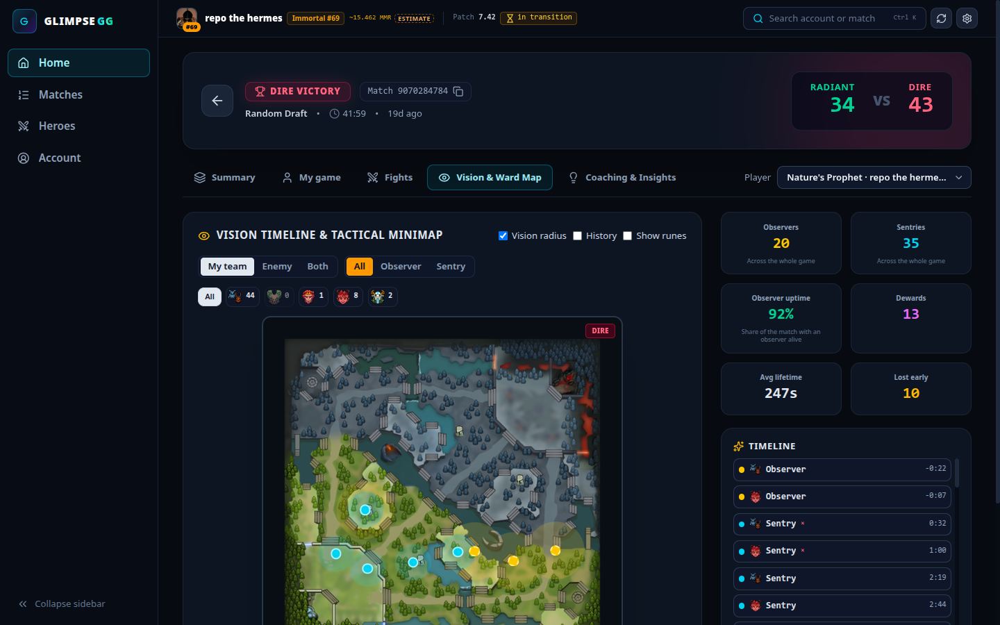

**`COACHING`** — deterministic diagnosis. Every card carries the number and its provenance, with
the sample size when there is one.

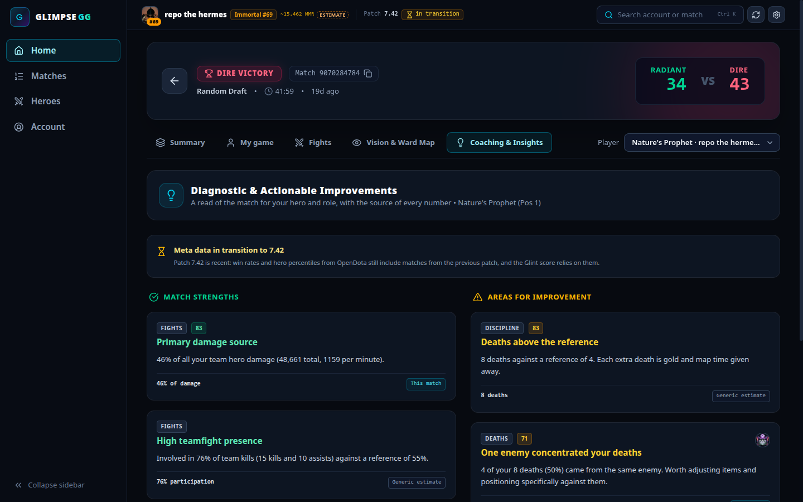

**Heroes** — your record on every hero, by period and patch, with the selected hero's latest matches
beside the list; fewer than 5 matches is marked as a small sample.

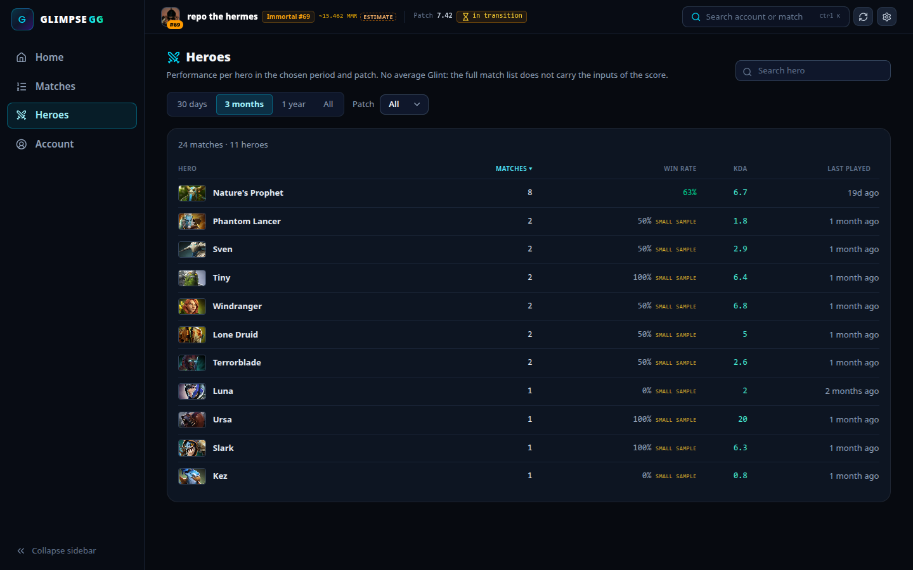

**Account** — your Glint, win rate and farm over time, career totals with the sample size of each
line, queue and rank, records and breakdowns.

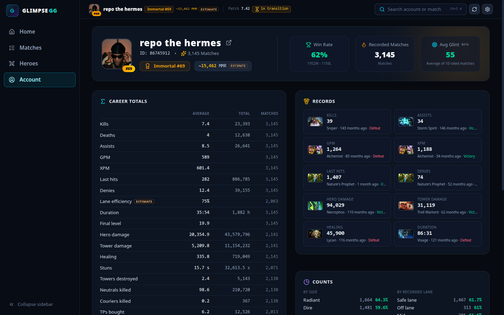

**Hero grid — the mirror** — a replica of what the app wrote into your Dota layout collection, with
the groups in their in-game positions and the GlimpseScore that set the order inside each one.

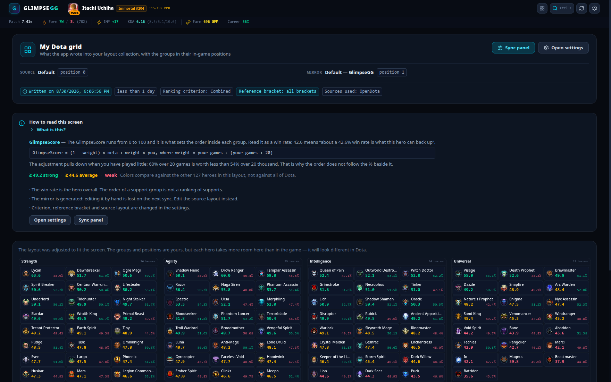

**Hero grid — sync panel** — when the grid was last written, from which source, and the
hero-by-hero ranking with the meta and personal components of every score.

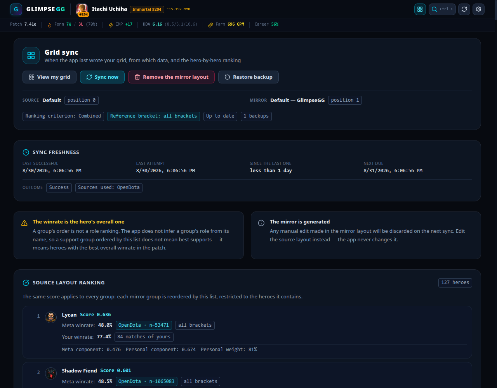

**Search** — look a player up by SteamID32/64, vanity URL or name, or open a match by its ID, with
history and favourites. Opens with `Ctrl K`.

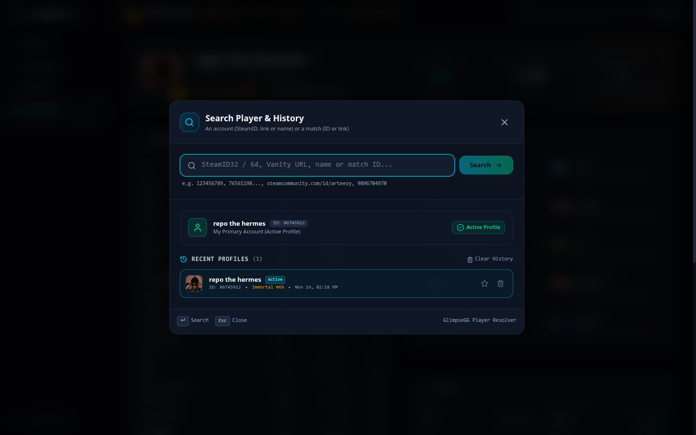

**Settings** — interface language, active Steam account and the hero grid configuration.

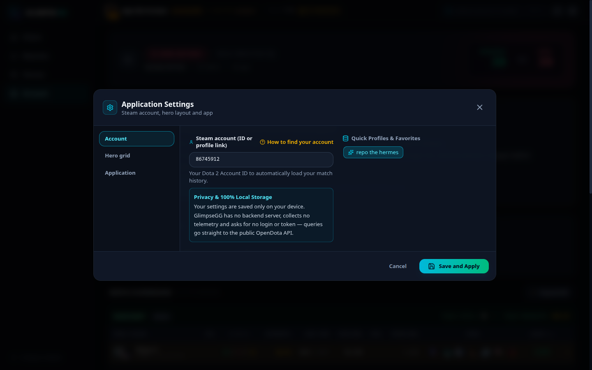

**Onboarding** — the first run asks for the interface language (English by default) and the Steam
account to follow. No token is requested.

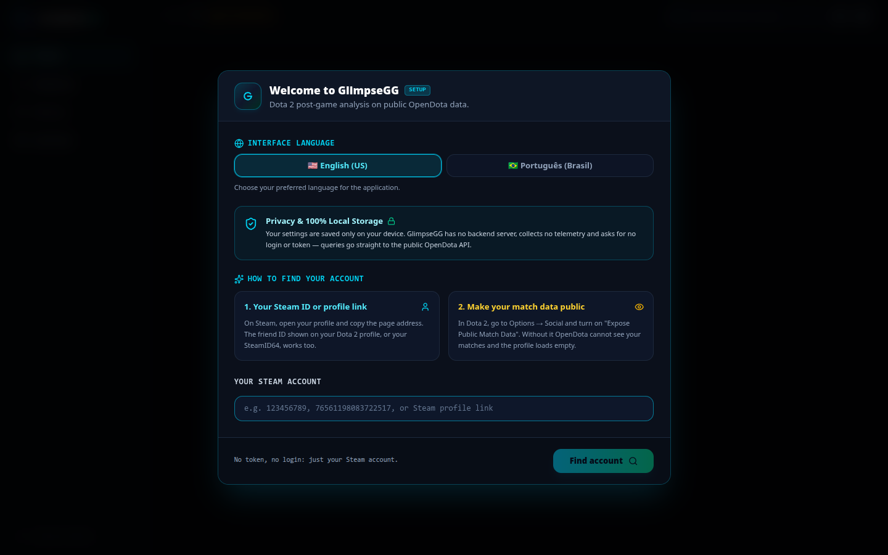

## Requirements

- Node.js 24+
- npm 10+

## Installation

Download the binary for your platform from the [Releases](https://github.com/MarcosRosado/glimpsegg/releases)
page:

| Platform | Artifact |
| --- | --- |
| Windows | `GlimpseGG-Setup-<version>-x64.exe` (installer) or `GlimpseGG-Portable-<version>-x64.exe` |
| Linux | `GlimpseGG-<version>-linux-x86_64.AppImage` |
| macOS | `GlimpseGG-<version>-mac-<arch>.dmg` |

The app updates itself from this repository's Releases.

## No token required

GlimpseGG needs no API token and no account. Everything it shows comes from public endpoints.

Earlier versions required a personal STRATZ token. If you used one of them, that token may still be
sitting in the local config file (see [What is stored locally](#what-is-stored-locally)). The app no
longer uses it, but it is still a secret:

> [!WARNING]
> **A personal STRATZ token cannot be revoked.** If it leaks, it stays valid until the expiry date
> embedded in the JWT. Never commit it, and never paste it into issues, pull requests or
> screenshots. It is a Bearer token: whoever holds the value spends your API quota.

## Privacy

**GlimpseGG has no server of its own.** There is no backend, no database and no service operated by
this project. Nothing you do in the app is sent to any infrastructure of ours, because none exists.

Practical consequences:

- **None of your data is stored on a server.** There is no sign-up, account, login or profile on the
  project's side.
- **No telemetry, no analytics.** The app collects no usage metrics, has no crash reporter and
  embeds no tracking SDK.
- **No credential is involved.** The app asks for no token, key or login for any third-party
  service.

The app is only a client: it talks directly to public third-party APIs to build the screens. For
transparency, everything it communicates with:

| Destination | What for | What is sent |
| --- | --- | --- |
| `api.opendota.com` | Profiles, match history and details, replay parse requests, hero win rates, teammates, player search | The Steam Account ID, the match ID or the search term |
| `cdn.cloudflare.steamstatic.com` | Hero and item icons (Valve) | Nothing beyond the image request |
| `avatars.steamstatic.com` | Player avatars (Valve) | Nothing beyond the image request |
| `www.opendota.com` | Rank icons | Nothing beyond the image request |
| `fonts.googleapis.com`, `fonts.gstatic.com` | Inter and JetBrains Mono fonts | Nothing beyond the font request |
| `github.com` | App update check | Nothing beyond the version being queried |

A Content-Security-Policy in the production bundle restricts connections to exactly that list —
any other destination is blocked by Chromium itself.

### What is stored locally

Settings — interface language, Steam account, hero grid preferences — are kept in plain text,
**locally**, unencrypted:

- **Desktop:** `glimpsegg_config.json` inside Electron's `userData` directory
  (`~/.config/GlimpseGG` on Linux, `%APPDATA%\GlimpseGG` on Windows,
  `~/Library/Application Support/GlimpseGG` on macOS). Before 2.0 it was called
  `stratz_app_config.json`; on first launch the app copies your settings over and leaves the
  old file untouched.
- **Browser (dev):** `localStorage`.

A STRATZ token saved by an earlier version may still be there (`stratzApiKey` in the old
`stratz_app_config.json`, `stratz_api_key` in `localStorage`). The app does not use it, and it is
not copied to the new file. Treat the machine as the trust
boundary: any process with access to your user profile can read that file.

## Development

```bash
npm install
npm run electron:dev     # Vite + Electron with HMR
```

No `.env` is needed to run the app.

Other scripts:

| Script | What it does |
| --- | --- |
| `npm run dev` | Vite only, in the browser (without the Electron APIs) |
| `npm run build` | Type-check (`tsc -b`) + production bundle |
| `npm run electron:start` | Electron over the already-compiled bundle |
| `npm run electron:test-clean` | Electron with an isolated `userData`, to test onboarding from scratch |
| `npm run icons:generate` | Rasterizes every icon from `build/icon.svg` |
| `npm run icons:check` | Checks that the icon binaries are in sync with the master |
| `npm test` | Unit tests (vitest) of the pure functions — runs in CI before the build |
| `npm run test:watch` | Same, in watch mode |
| `npm run dist` | Packages the Linux AppImage |
| `npm run dist:all` | Packages macOS + Windows + Linux |

Tests live in [`tests/`](tests/), mirroring the source tree — they are not co-located with the
code. `src/` and `electron/` hold only what the app ships.

### Visual identity

The brand art lives in two places, and **changing one requires reviewing the other**:

| File | Role |
| --- | --- |
| `build/icon.svg` | Master source of the app icon. Every PNG, the `.ico` and `public/favicon.svg` are **generated** from it — do not hand-edit the derivatives. |
| `src/components/brand/BrandMark.tsx` | In-app monogram (navbar, splash, onboarding). Hand-redrawn on a 24px grid, `currentColor`. |

After touching the master, run `npm run icons:generate` and **commit the binaries together with the
SVG**: CI does not regenerate icons, so a commit without them publishes a release with the old art
and no sign of an error. `npm run icons:check` runs in CI precisely to stop that.

Two constraints on the master, both enforced by a preflight in the generator:

- **No text elements** — the font fontconfig resolves varies per machine
  (`fc-match "JetBrains Mono"` returns Noto Sans here), so the same SVG would rasterize differently
  in each place. Letters go in as `<path>`.
- **ImageMagick with the `RSVG` delegate** — without librsvg, ImageMagick falls back to its internal
  `MSVG` renderer, which ignores gradients and filters and would produce a destroyed icon with no
  error.

### Data sources

- **OpenDota** (REST, `api.opendota.com`) — profiles, match history and match details, replay parse
  requests, the hero win rates behind the hero grid, teammates, vanity URL lookup. Public, no key.
- **Valve** — hero and item art and player avatars, from the Steam CDN. The item catalogue shipped
  with the app is generated at development time from Valve's datafeed
  (`scripts/sync-items-full.cjs`).
- **STRATZ** — no longer queried. It remains the inspiration for the screens.

No language model is involved anywhere. The coaching engine is deterministic: every number on screen
traces back to a specific field of the source response, and the card shows its provenance, with the
sample size when there is one. When OpenDota has not parsed the replay, the corresponding analysis
simply does not appear — nothing is estimated to fill the gap.

### Third-party assets

- `public/minimap.png` — Dota 2 minimap (patch 7.41), taken from
  <https://liquipedia.net/dota2/Minimap>. It is Valve art, included here only to render ward
  placement. It is not covered by this repository's MIT license. The coordinate mapping was
  calibrated against this image: with map cells 64–192 stretched edge to edge, the river's two
  power runes land on water and 97% of a 544 real-ward sample lands on terrain.

## Releases

Every push to `main` bumps the patch version, creates the tag and publishes a release with the
artifacts for all three platforms, via GitHub Actions. The gates are `icons:check`, `npm test` and
`npm run build` — a red test blocks the release. A major or minor release (such as 2.0.0) is made
by setting `version` in `package.json` once, in the release commit; the workflow then uses it
instead of bumping the patch. If `docs/release-notes/v<version>.md` exists, it becomes the release
notes.

## Contact

Marcos Rosado — <contato@marcosrosado.dev>

Bugs and suggestions: open an [issue](https://github.com/MarcosRosado/glimpsegg/issues).
Never include a token or any other secret in issues, logs or screenshots.

## License

MIT — see [LICENSE](LICENSE).
