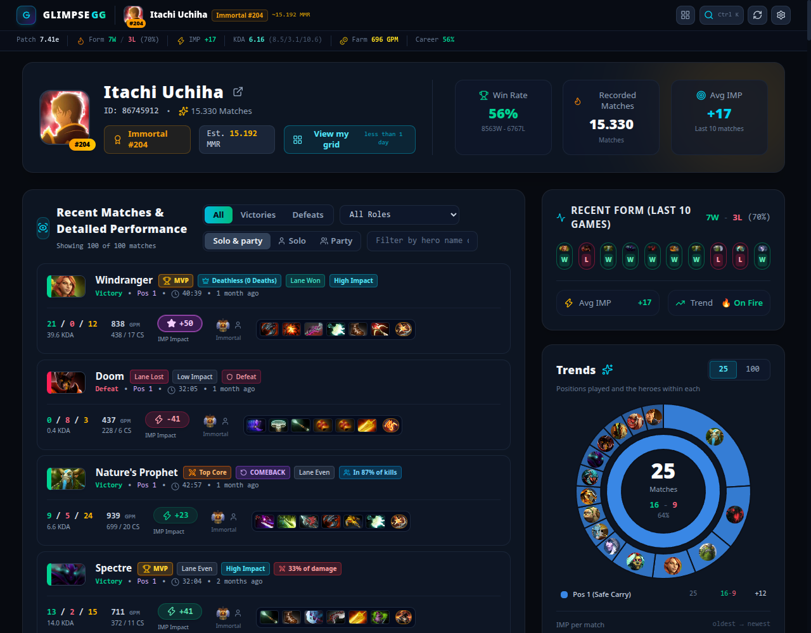
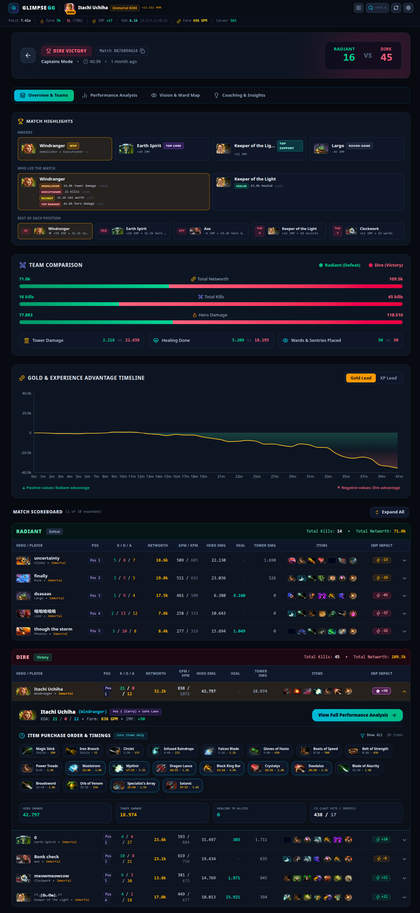
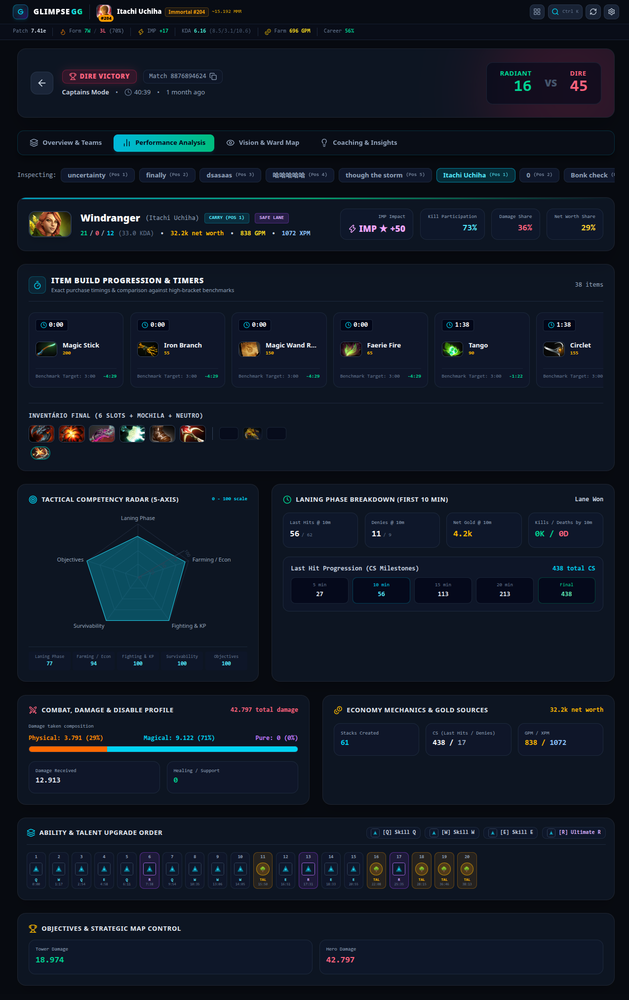
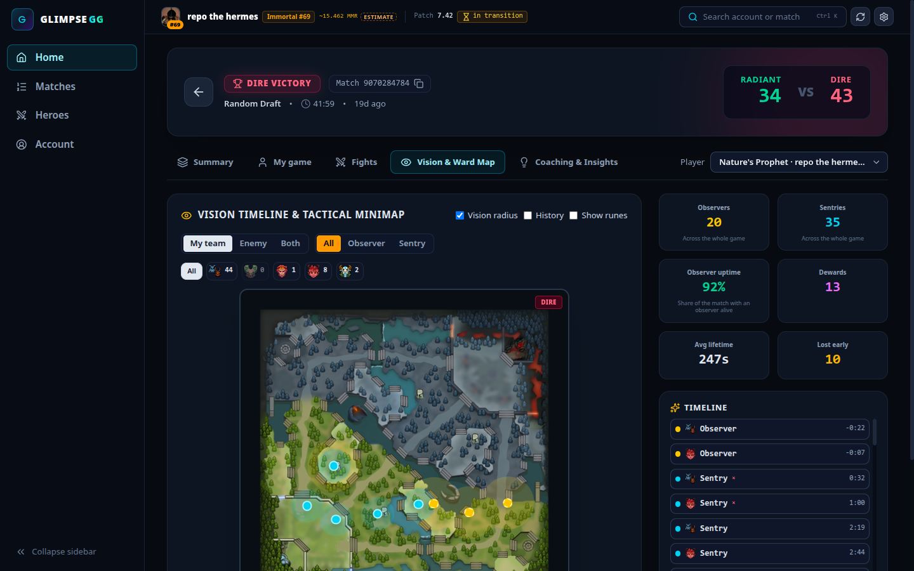
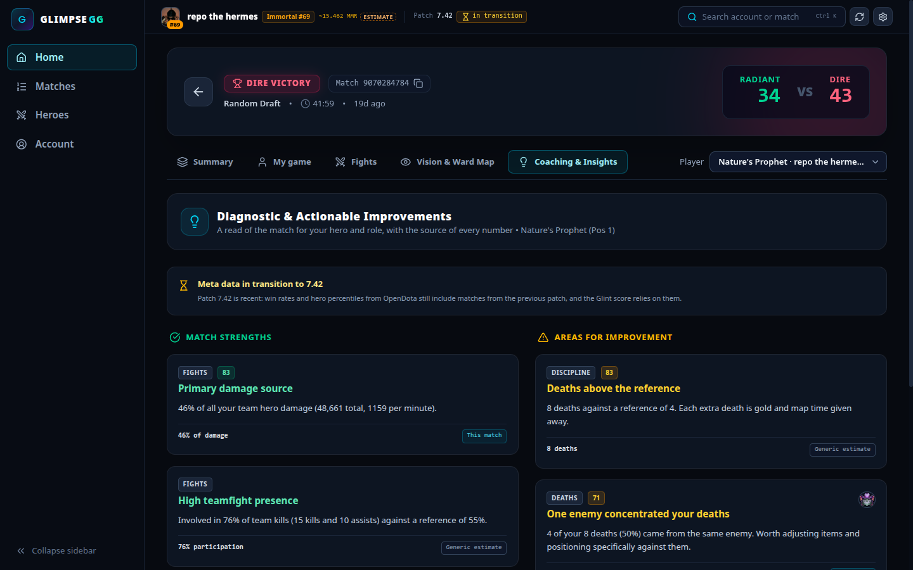
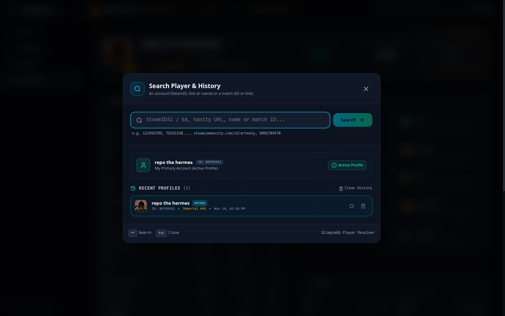
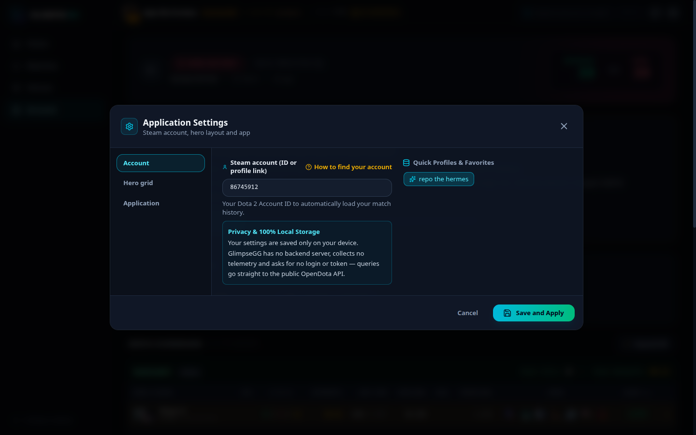
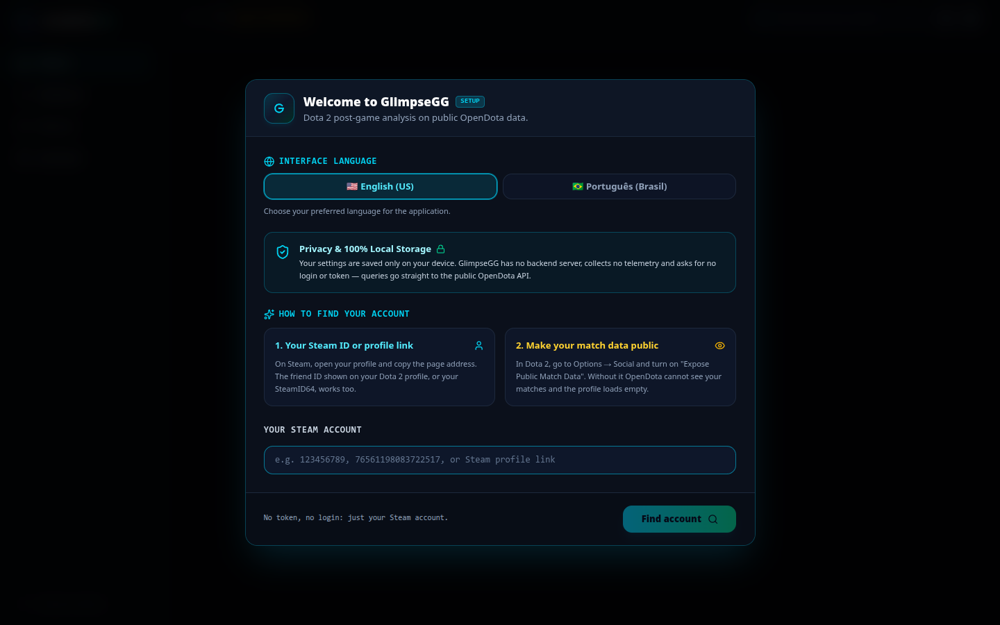

# GlimpseGG

[English](README.md) · **Português (pt-BR)**

Aplicativo desktop de análise pós-jogo de Dota 2. Lê dados públicos da OpenDota, com a arte de
heróis e itens vinda da Valve, e transforma uma partida já encerrada em leitura tática: scoreboard,
timeline de vantagem, mapa de visão e insights por jogador. **Nenhum token de API é exigido.**

Construído com Electron + React + TypeScript + Vite. Interface em português (pt-BR) e inglês (en-US).

## Por que existe

O GlimpseGG nasceu para **manter atualizado o que a STRATZ mostrava**. A STRATZ parou de receber
atualizações, e o custo disso aparece a cada patch — heróis e itens novos não entram nas bases,
então partidas que os incluem ficam sem exibição correta e fora de qualquer análise.

As primeiras versões liam da API da STRATZ e exigiam um token pessoal. Isso acabou: **o app não faz
nenhuma chamada à STRATZ e não precisa de token.** Perfil, partida e meta vêm da OpenDota, que é
pública; a arte de heróis e itens vem da Valve.

As telas, e o tipo de leitura que elas tentam entregar, continuam **inspiradas na STRATZ** — o
crédito é devido. O que o GlimpseGG não consegue é reproduzir os números da própria STRATZ, e ele
não finge que consegue: a nota de impacto exibida aqui se chama **Glint**. Ela é do GlimpseGG, é
**experimental**, e não é o IMP da STRATZ nem pretende equivaler a ele.

## Recursos

**Dashboard do jogador**
- Perfil, rank e forma recente
- Lista de partidas com resumo por jogo
- Heróis mais jogados e tendência de performance
- Heatmap de atividade
- Matriz de duplas

**Análise de partida** — quatro abas por jogador
- `OVERVIEW` — scoreboard, visão geral dos times, timeline de vantagem
- `PERFORMANCE` — métricas contra baseline de herói/posição
- `VISION` — wards reais no minimapa, com tempo de vida, autor, dewards e cobertura
- `COACHING` — diagnóstico determinístico da partida, com forense de morte; todo card diz de onde
  vem o número
- **Glint** — a nota de impacto experimental, por jogador (veja [Por que existe](#por-que-existe))

O que cada aba mostra depende do que a OpenDota tem daquela partida. Quando falta um dado, a seção
é escondida — nunca estimada. A recomendação de build das versões anteriores está escondida por
esse motivo: a OpenDota não tem volume para sustentá-la.

**Layout espelho de heróis** — grava uma cópia do seu layout do Dota, reordenada por win rate
- O seu layout **nunca é alterado**: o espelho é um elemento **novo** ao lado dele, e a gravação
  aborta se qualquer outra coisa no arquivo tiver mudado
- Ordenado pelo GlimpseScore, que combina o win rate do meta no patch com o seu próprio histórico
- Não precisa de token — o win rate de meta vem da OpenDota

## Telas

As capturas abaixo saem do app em execução, mas **são anteriores à saída da STRATZ**: algumas ainda
mostram campo de token, cards de build ou a nota de impacto antiga. Até serem refeitas, vale o
texto, não a imagem. O perfil exibido é uma conta pública de alto ranque (`86745912`), usada apenas para ilustrar as telas —
nenhum dado do mantenedor aparece aqui. As telas de hero grid usam um **layout fictício** agrupado
pelos quatro atributos, como o Dota entrega por padrão: o grid é um arquivo local, então não existe
"o grid de outro jogador" para exibir.

**Dashboard do jogador** — perfil e rank, forma recente, lista de partidas com resumo por jogo,
heróis principais e tendências.



**`OVERVIEW`** — prêmios da partida, comparativo entre as equipes, linha do tempo de vantagem de
ouro/XP e o scoreboard, com a ordem e o tempo de compra de cada item do jogador aberto.



**`PERFORMANCE`** — cronômetro de itens contra a meta do benchmark, radar de competências, métricas
dos primeiros 10 minutos, composição do dano e sequência de habilidades.



**`VISION`** — wards reais sobre o minimapa, com raio de visão, tempo de vida, autor, dewards e
cobertura, navegáveis pela linha do tempo da partida.



**`COACHING`** — diagnóstico determinístico. Cada card traz o número e a procedência, com o tamanho
da amostra quando há uma.



**Hero grid — o espelho** — a réplica do que o app gravou na sua coleção de layouts do Dota, com os
grupos nas posições que ocupam no jogo e o GlimpseScore que definiu a ordem dentro de cada um.


**Hero grid — painel de sincronização** — quando o grid foi gravado pela última vez, a partir de
qual fonte, e o ranking herói a herói com as componentes de meta e pessoal de cada nota.


**Busca de jogador** — procura por SteamID32/64, vanity URL ou nome, com histórico e favoritos.
Abre com `Ctrl K`.



**Configurações** — idioma da interface, conta Steam ativa e a configuração do layout espelho.



**Onboarding** — a primeira execução pede o idioma da interface (inglês por padrão) e a conta Steam
a acompanhar. Nenhum token é pedido.



## Requisitos

- Node.js 24+
- npm 10+

## Instalação

Baixe o binário da sua plataforma na página de [Releases](https://github.com/MarcosRosado/glimpsegg/releases):

| Plataforma | Artefato |
| --- | --- |
| Windows | `GlimpseGG-Setup-<versão>-x64.exe` (instalador) ou `GlimpseGG-Portable-<versão>-x64.exe` |
| Linux | `GlimpseGG-<versão>-linux-x86_64.AppImage` |
| macOS | `GlimpseGG-<versão>-mac-<arch>.dmg` |

O app se atualiza sozinho a partir das Releases deste repositório.

## Nenhum token é exigido

O GlimpseGG não precisa de token de API nem de conta. Tudo o que ele mostra vem de endpoints
públicos.

Versões anteriores exigiam um token pessoal da STRATZ. Se você usou alguma delas, esse token pode
continuar no arquivo de configuração local (veja
[O que fica armazenado localmente](#o-que-fica-armazenado-localmente)). O app não o usa mais, mas
ele continua sendo um segredo:

> [!WARNING]
> **O token pessoal da STRATZ não pode ser revogado.** Se ele vazar, permanece válido até a data de
> expiração embutida no JWT. Nunca commite o token, nem cole em issues, pull requests ou prints de
> tela. Ele é um Bearer token: quem tiver o valor consome a sua quota de API.

## Privacidade

**GlimpseGG não tem servidor próprio.** Não existe backend, banco de dados ou serviço
operado por este projeto. Nada que você faz no app é enviado para nenhuma infraestrutura
nossa, porque ela não existe.

Consequências práticas:

- **Nenhum dado seu é armazenado em servidor.** Não há cadastro, conta, login nem perfil
  do lado do projeto.
- **Nenhuma telemetria ou analytics.** O app não coleta métricas de uso, não tem crash
  reporter e não embute SDK de rastreamento.
- **Nenhuma credencial está envolvida.** O app não pede token, chave nem login de nenhum
  serviço de terceiros.

O app é apenas um cliente: ele fala direto com APIs públicas de terceiros para montar as
telas. Para transparência, tudo com que ele se comunica:

| Destino | Para quê | O que é enviado |
| --- | --- | --- |
| `api.opendota.com` | Perfis, histórico e detalhes de partida, pedidos de parse de replay, win rate de heróis, duplas, busca de jogador | O Steam Account ID, o ID da partida ou o termo de busca |
| `cdn.cloudflare.steamstatic.com` | Ícones de heróis e itens (Valve) | Nada além da requisição da imagem |
| `avatars.steamstatic.com` | Avatares de jogadores (Valve) | Nada além da requisição da imagem |
| `www.opendota.com` | Ícones de rank | Nada além da requisição da imagem |
| `fonts.googleapis.com`, `fonts.gstatic.com` | Fontes Inter e JetBrains Mono | Nada além da requisição da fonte |
| `github.com` | Verificação de atualização do app | Nada além da versão consultada |

Uma Content-Security-Policy no bundle de produção restringe as conexões exatamente a
essa lista — qualquer outro destino é bloqueado pelo próprio Chromium.

### O que fica armazenado localmente

As configurações — idioma da interface, conta Steam, preferências do layout espelho — ficam em
texto claro, **localmente**, sem criptografia:

- **Desktop:** `glimpsegg_config.json` dentro do diretório `userData` do Electron
  (`~/.config/GlimpseGG` no Linux, `%APPDATA%\GlimpseGG` no Windows,
  `~/Library/Application Support/GlimpseGG` no macOS). Até a 2.0 ele se chamava
  `stratz_app_config.json`; no primeiro início o app copia as configurações e deixa o arquivo
  antigo intocado.
- **Browser (dev):** `localStorage`.

Um token da STRATZ salvo por uma versão anterior pode continuar lá (`stratzApiKey` no
`stratz_app_config.json` antigo, `stratz_api_key` no `localStorage`). O app não o usa, e ele não é
copiado para o arquivo novo. Trate a máquina como o limite de confiança:
qualquer processo com acesso ao seu perfil de usuário consegue ler esse arquivo.

## Desenvolvimento

```bash
npm install
npm run electron:dev     # Vite + Electron com HMR
```

Nenhum `.env` é necessário para rodar o app.

Outros scripts:

| Script | O que faz |
| --- | --- |
| `npm run dev` | Só o Vite, no browser (sem as APIs do Electron) |
| `npm run build` | Type-check (`tsc -b`) + bundle de produção |
| `npm run electron:start` | Electron sobre o bundle já compilado |
| `npm run electron:test-clean` | Electron com `userData` isolado, para testar o onboarding do zero |
| `npm run icons:generate` | Rasteriza todos os ícones a partir de `build/icon.svg` |
| `npm run icons:check` | Confere se os binários de ícone estão em sincronia com o master |
| `npm test` | Testes unitários (vitest) das funções puras — roda no CI antes do build |
| `npm run test:watch` | Idem, em modo watch |
| `npm run dist` | Empacota AppImage para Linux |
| `npm run dist:all` | Empacota macOS + Windows + Linux |

Os testes moram em [`tests/`](tests/), espelhando a árvore do código — não ficam junto dele. `src/` e
`electron/` contêm só o que o app embarca.

### Identidade visual

A arte da marca vive em dois lugares, e **alterar um exige revisar o outro**:

| Arquivo | Papel |
| --- | --- |
| `build/icon.svg` | Fonte-mestre do ícone de app. Todos os PNGs, o `.ico` e o `public/favicon.svg` são **gerados** dele — não edite os derivados à mão. |
| `src/components/brand/BrandMark.tsx` | Monograma in-app (Navbar, splash, onboarding). Redesenho manual na grade de 24px, `currentColor`. |

Depois de mexer no master, rode `npm run icons:generate` e **commite os binários junto com o SVG**:
o CI não regenera ícones, então um commit sem eles publica uma release com a arte antiga sem
qualquer sinal de erro. O `npm run icons:check` roda no CI justamente para barrar isso.

Duas restrições do master, ambas impostas por preflight no gerador:

- **Nada de elementos de texto** — a fonte que o fontconfig resolve varia por máquina
  (`fc-match "JetBrains Mono"` aqui devolve Noto Sans), então o mesmo SVG rasterizaria diferente
  em cada lugar. Letras vão como `<path>`.
- **ImageMagick com delegate `RSVG`** — sem librsvg o ImageMagick cai no renderizador `MSVG`
  interno, que ignora gradientes e filtros e produziria um ícone destruído sem erro.

### Fontes de dados

- **OpenDota** (REST, `api.opendota.com`) — perfis, histórico e detalhes de partida, pedidos de
  parse de replay, o win rate de heróis por trás do layout espelho, duplas, busca por vanity URL.
  Público, sem chave.
- **Valve** — arte de heróis e itens e avatares de jogadores, pela CDN da Steam. O catálogo de
  itens que o app embarca é gerado em tempo de desenvolvimento a partir do datafeed da Valve
  (`scripts/sync-items-full.cjs`).
- **STRATZ** — não é mais consultada. Segue como a inspiração das telas.

Não há nenhum modelo de linguagem envolvido. O motor de coaching é determinístico: cada número
exibido rastreia para um campo específico da resposta da fonte, e o card mostra a procedência, com
o tamanho da amostra quando há uma. Quando a OpenDota não processou o replay, a análise
correspondente simplesmente não aparece — nada é estimado para preencher a lacuna.

### Assets de terceiros

- `public/minimap.png` — minimapa do Dota 2 (patch 7.41), obtido em
  <https://liquipedia.net/dota2/Minimap>. É arte da Valve, incluída aqui apenas para
  renderizar o posicionamento de wards. Não é coberta pela licença MIT deste repositório.
  O mapeamento de coordenadas foi calibrado contra esta imagem: com as células 64–192 do
  mapa esticadas de borda a borda, as duas runas de poder do rio caem sobre a água e
  97% de uma amostra de 544 wards reais caem sobre terreno.

## Releases

Todo push na `main` incrementa a versão patch, cria a tag e publica uma release com os artefatos das
três plataformas, via GitHub Actions. Os gates são `icons:check`, `npm test` e `npm run build`
— um teste vermelho bloqueia a release.

## Contato

Marcos Rosado — <contato@marcosrosado.dev>

Bugs e sugestões: abra uma [issue](https://github.com/MarcosRosado/glimpsegg/issues).
Nunca inclua token nem qualquer outro segredo em issues, logs ou prints.

## Licença

MIT — veja [LICENSE](LICENSE).
